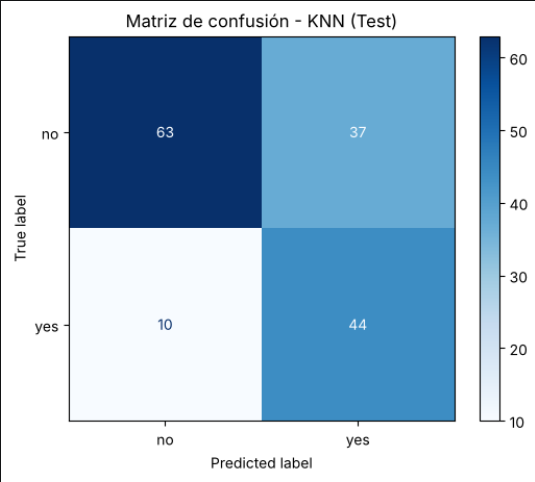

# Diagnóstico de Diabetes con KNN Ponderado y Preprocesamiento Clínico

Proyecto de clasificación supervisada con K-Nearest Neighbors (KNN) aplicado al dataset de Pima Indians Diabetes. El objetivo principal fue optimizar la tasa de detección clínica (Sensibilidad / Recall) para reducir al mínimo los casos de pacientes con diabetes no diagnosticadas.

---

## 1. Arquitectura del Flujo y Pipeline

Para evitar fuga de datos (data leakage), la partición de prueba (Test 20%) se aisló desde el inicio. Todo el proceso de imputación, escalado y balanceo se ejecutó exclusivamente dentro de cada iteración de validación cruzada:

  

---

## 2. Limpieza y Preprocesamiento

* **Manejo de ceros clínicos:** Variables como Glucosa, Presión Arterial, Grosor del Pliegue Cutáneo, Insulina e IMC no pueden tener valor 0 en personas vivas. Se identificaron como errores de captura y se reemplazaron por valores nulos (NaN).
* **Tratamiento en Embarazos (Pregnancies):** En esta variable el valor 0 sí es biológicamente posible. Al analizar la distribución por edades, se comprobó que los valores faltantes correspondían a mujeres jóvenes sin gestaciones previas, recodificándolos formalmente como 0.
* **Evaluación de Outliers:** Se aplicó la prueba de normalidad multivariada de Henze-Zirkler (p < 0.001), descartando la normalidad de los datos. Tras comparar métodos univariados y multivariados (IQR, Z-Score, MAD, Isolation Forest y LOF), se decidió conservar los valores atípicos ya que son clínicamente plausibles y representan casos reales de la clase de interés.
* **Imputación Multivariada:** Se comparó MICE (IterativeImputer con BayesianRidge) frente a métodos simples de media y mediana bajo validación cruzada. MICE superó a las alternativas en todas las métricas evaluadas (Recall de 0.6118 y ROC-AUC de 0.7962).
* **Estrategia de Balanceo:** Se evaluaron distintas técnicas dentro del flujo de trabajo. SMOTE + ENN obtuvo el desempeño más alto (Recall de 0.8179, F1 de 0.6853 y ROC-AUC de 0.8075) gracias a que depura los ejemplos ambiguos en las fronteras entre clases antes de aplicar el algoritmo.

---

## 3. Optimización con GridSearchCV

El ajuste de hiperparámetros se realizó mediante validación cruzada estratificada de 5 particiones dentro de un pipeline:

* **Criterio de Selección:** Maximización de Recall con desempate por F1-Score ante diferencias menores a 0.005.
* **Vecinos evaluados (n_neighbors):** [3, 5, 7, 9, 11, 15, 21, 25, 31, 41, 51, 61]
* **Ponderación (weights):** Uniforme vs. Inversa a la distancia (w = 1 / [d + 1e-6])
* **Métrica de distancia Minkowski (p):** [1 (Manhattan), 1.5, 2 (Euclidiana), 3, 4]

### Configuración del Mejor Modelo
* **Vecinos óptimos (K):** 11
* **Ponderación:** Inversa a la distancia
* **Métrica Minkowski (p):** 3
* **Recall en Validación Cruzada:** 0.8458 (+- 0.0234)
* **F1-Score en Validación Cruzada:** 0.6947
* **ROC-AUC en Validación Cruzada:** 0.8271

---

## 4. Resultados en el Conjunto de Test

Evaluación final sobre el 20% de datos apartados (154 pacientes):

* **Recall (Sensibilidad):** 81.48% (44 de 54 pacientes con diabetes detectadas)
* **Precision:** 54.32%
* **F1-Score:** 65.19%
* **Accuracy:** 69.48%
* **ROC-AUC:** 0.7759

### Matriz de Confusión

  

* **Verdaderos Negativos (TN):** 63 pacientes sanas diagnosticadas correctamente.
* **Falsos Positivos (FP):** 37 pacientes sanas derivadas a seguimiento.
* **Falsos Negativos (FN):** 10 casos no detectados oportunamente.
* **Verdaderos Positivos (TP):** 44 casos confirmados.
